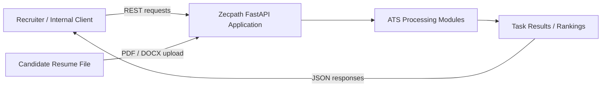
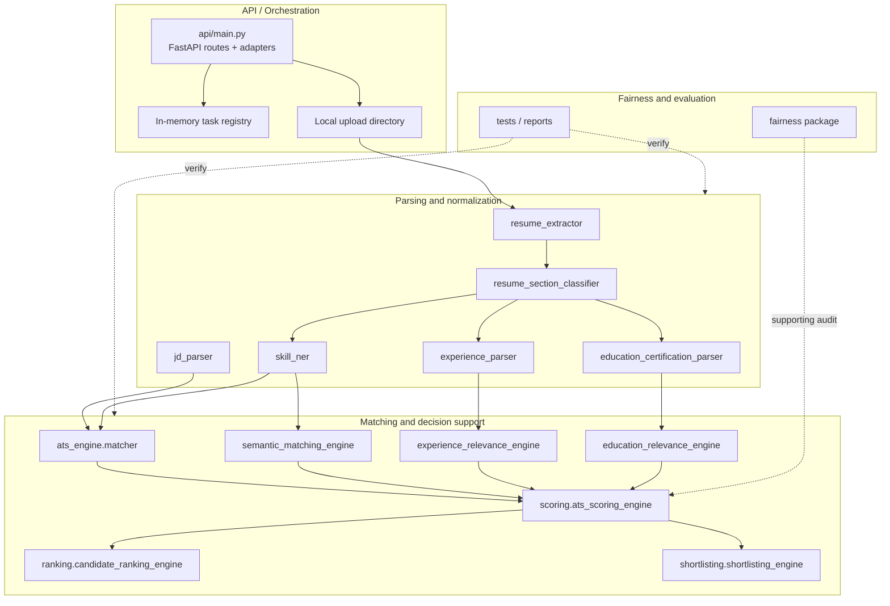
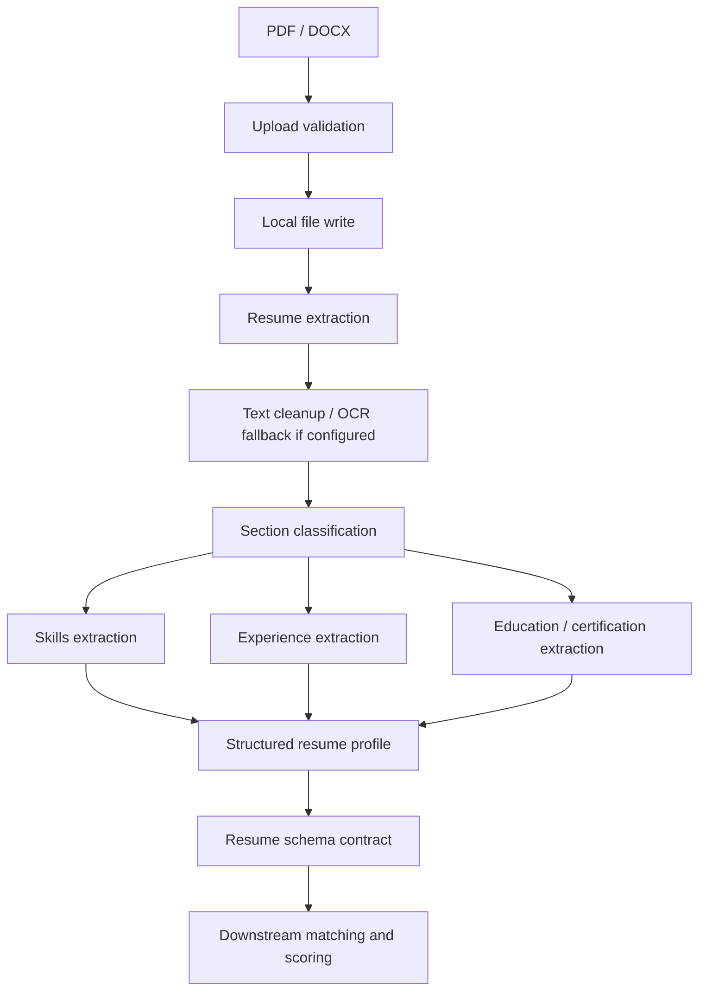
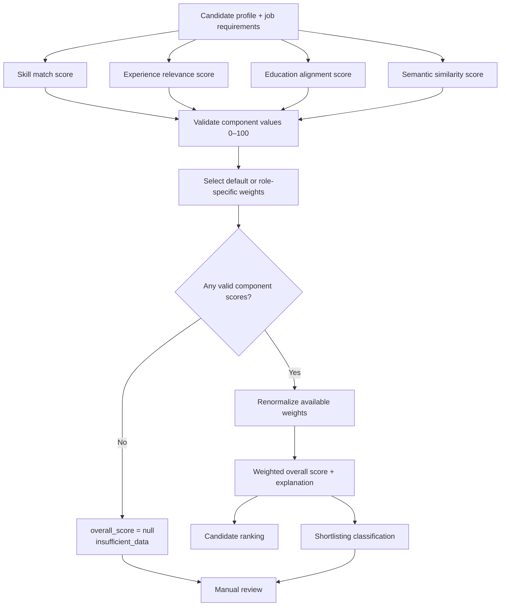
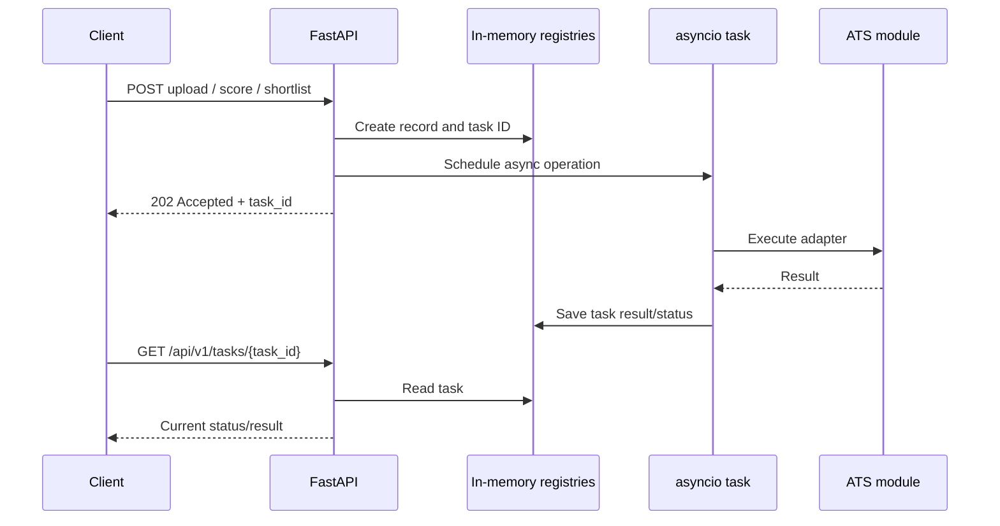

# Zecpath ATS — Architecture Diagrams

**Day 19 deliverable | Version 1.0**

These diagrams describe the repository's current logical architecture. They are not deployment diagrams for a production microservices environment.

## 1. System context

## 2. Component architecture

## 3. Resume processing data flow

## 4. Scoring and ranking flow

## 5. API request lifecycle

**Important limitation:** The task registry and related API state are in memory. This sequence does not provide durable execution, cross-process coordination, or recovery after a restart.
