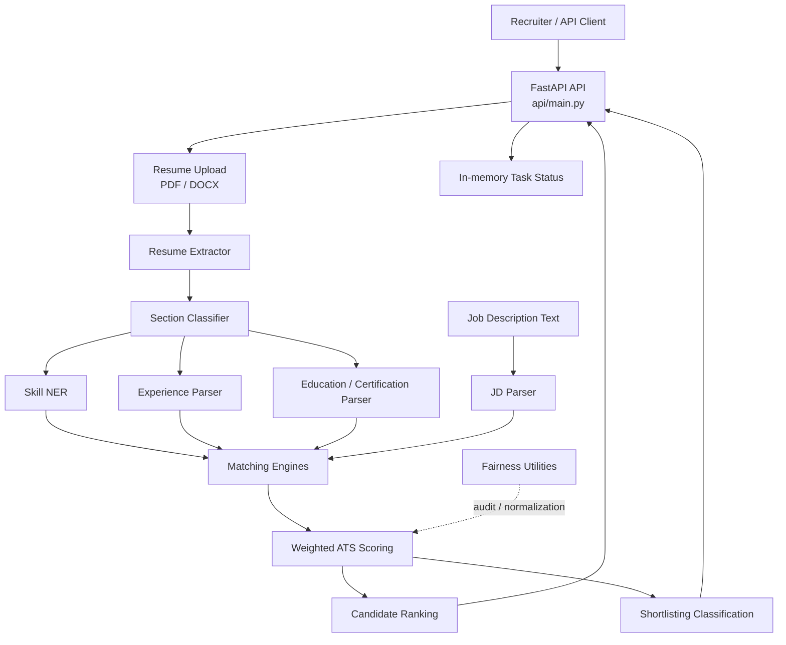

# Zecpath ATS — Technical Documentation

**Document:** Day 19 — ATS Documentation & Knowledge Transfer  
**Version:** 1.0  
**Status:** Repository-based technical reference  
**Scope:** Current implementation in this repository snapshot

## 1. Purpose and system boundary

Zecpath ATS is a modular Python codebase for extracting structured information from resumes and job descriptions, comparing candidate profiles with job requirements, calculating explainable relevance scores, ranking candidates, and classifying candidates for recruiter review.

This repository is an **AI development foundation / prototype**, not a complete production hiring platform. In particular, the API stores resume records, tasks, and rankings in process memory. Those records are lost when the API process restarts. The repository does not demonstrate production authentication, authorization, durable task queues, a persistent application database, or deployment hardening.

Scores are decision-support signals. They are not calibrated probabilities and must not be used as the sole basis for hiring decisions.

## 2. High-level capabilities

| Capability | Main location | Responsibility |
|---|---|---|
| Resume text extraction | `parsers/resume_extractor.py` | Extract text from supported documents; use OCR fallback where configured |
| Resume segmentation | `parsers/resume_section_classifier.py` | Identify canonical resume sections and retain unclassified content |
| Skill extraction | `parsers/skill_ner.py` | Detect and normalize skills using spaCy PhraseMatcher and a skill dictionary |
| Education and certification parsing | `parsers/education_certification_parser.py` | Extract education and certification details |
| Experience parsing | `parsers/experience_parser.py` | Extract employment history and normalize dates/durations |
| Job description parsing | `parsers/jd_parser.py` | Convert job-description text into structured role and requirement data |
| Skill overlap | `ats_engine/matcher.py` | Calculate required-skill coverage |
| Semantic matching | `ats_engine/semantic_matching_engine.py` | Compare resume and job text using sentence embeddings and cosine similarity |
| Experience relevance | `ats_engine/experience_relevance_engine.py` | Estimate relevance of prior experience to a target role |
| Education relevance | `ats_engine/education_relevance_engine.py` | Compare education details against job requirements |
| Weighted ATS scoring | `scoring/ats_scoring_engine.py` | Combine component scores with configured weights and an auditable breakdown |
| Candidate ranking | `ranking/candidate_ranking_engine.py` | Rank candidates per job using overall score |
| Shortlisting | `shortlisting/shortlisting_engine.py` | Classify candidates into shortlist, review, or reject categories |
| Fairness utilities | `fairness/` | Normalize resume data, mask personal attributes, and evaluate bias indicators |
| REST API | `api/main.py` | Expose upload, parsing, scoring, shortlisting, rankings, and task-status operations |
| Reports | `reports/` | Store evaluation, performance, and fairness documentation/reports |

## 3. Runtime architecture

The implementation is organized as Python modules rather than independently deployed microservices. The FastAPI application acts as an integration layer around these modules.

**Interpretation:** The diagram shows the logical processing path. It does not imply that every parser and matching engine is automatically invoked by every API endpoint. The API currently exposes separate operations and adapters; some batch scripts orchestrate wider processing pipelines.

## 4. Important modules and interfaces

### 4.1 Resume extraction and parsing

- `parsers/resume_extractor.py` is the document extraction entry point used by the API adapter.
- The README describes PDF and DOCX extraction, text cleanup, and OCR fallback for scanned documents / embedded images when the required OCR dependencies are installed.
- `parsers/resume_section_classifier.py` identifies common headings and maps them to canonical sections. Confidence values are heuristic signals.
- `parsers/skill_ner.py` uses spaCy PhraseMatcher and a canonical dictionary. The default dictionary location is `data/skill_dictionary.json`; batch scripts can accept a custom dictionary path.
- `parsers/experience_parser.py` extracts employment records and normalizes date formats.
- `parsers/education_certification_parser.py` extracts education and certification records.

### 4.2 Job-description parsing

`parsers/jd_parser.py` extracts job information such as role/title and skill requirements. `job_description_schema.json` documents the structured JD data contract. The schema includes job identity, source document, role, workplace/location, responsibilities, skills, experience requirements, education, certifications, languages, compensation, application instructions, and extraction metadata.

### 4.3 Matching engines

- `ats_engine/matcher.py`: case-insensitive set overlap between required skills and candidate skills. The score is `matched required skills / total required skills × 100`. An empty required-skill list returns `0.0`.
- `ats_engine/semantic_matching_engine.py`: uses `sentence-transformers/all-MiniLM-L6-v2` by default. The model is loaded lazily on first use. Embeddings are compared with cosine similarity and normalized to `[0, 1]`. Section-level results are classified using configurable strong and moderate thresholds (defaults `0.75` and `0.55`). These are similarity signals, not probabilities.
- `ats_engine/experience_relevance_engine.py` and `ats_engine/education_relevance_engine.py`: provide relevance component outputs for the scoring layer.

### 4.4 Weighted ATS scoring

The scoring implementation is in `scoring/ats_scoring_engine.py`.

Default configured weights in `config/ats_scoring_weights.json`:

| Component | Default weight |
|---|---:|
| Skill match | 0.35 |
| Experience relevance | 0.25 |
| Education alignment | 0.15 |
| Semantic similarity | 0.25 |
| **Total** | **1.00** |

Role-specific profiles currently present:

| Role | Skill | Experience | Education | Semantic |
|---|---:|---:|---:|---:|
| AI Engineer | 0.40 | 0.20 | 0.15 | 0.25 |
| Python Developer | 0.35 | 0.30 | 0.10 | 0.25 |

Each component score must be numeric and within `0–100`. The scorer validates that configured weights are non-negative and sum to `1.0`. When a component is missing, it is excluded and the remaining available weights are renormalized. Missing components are not silently treated as zero.

For available component set \(A\), component score \(s_i\), and configured weight \(w_i\):

\[
\text{Overall Score} =
\frac{\sum_{i \in A} s_i w_i}{\sum_{i \in A} w_i}
\]

The output includes component-level scores, configured and effective weights, weighted contributions, missing components, data quality, category, engine version, and identifiers. `data_quality` is `complete`, `partial`, or `insufficient`. If no valid component score is available, the overall score is `null` and category is `insufficient_data`.

Scoring categories in the scorer are:
- `strong_match`: score ≥ 75
- `moderate_match`: score ≥ 50 and < 75
- `low_match`: score < 50

### 4.5 Ranking

`ranking/candidate_ranking_engine.py` sorts candidates by job, descending overall score, and candidate ID as a deterministic tie-breaker. Rank numbering is competition style (for example, `1, 1, 3`). Candidates without numeric scores remain in the output with `rank: null`.

### 4.6 Shortlisting

`shortlisting/shortlisting_engine.py` assigns one of:
- `shortlisted`
- `review`
- `rejected`

Incomplete scoring data always routes to manual review. Otherwise, the score is compared with `shortlist_min` and `review_min`.

**Configuration note:** `config/shortlisting_thresholds.json` currently contains `shortlist_min: 70` and `review_min: 60`. The shortlisting module's built-in defaults are `75` and `50`, and the API request model also defaults to `75` and `50`. The effective thresholds depend on the configuration passed by the caller. Align these values and document the selected source before production use.

### 4.7 Fairness utilities

The `fairness/` package contains resume normalization, personal-attribute masking, score normalization, bias evaluation, and keyword-dependence utilities. Supporting documentation and reports are in `reports/`.

Masking and normalization are mitigation/audit mechanisms; their presence does not prove that the model is unbiased. Fairness evaluation requires suitable, lawfully collected evaluation data, defined protected-group metrics, sufficient sample sizes, and human governance. Avoid inferring sensitive attributes from candidate data.

## 5. Data contracts

Two JSON Schema files define core structured data contracts:

- `resume_schema.json`: versioned candidate/resume structure including candidate contact fields, skills, experience, education, certifications, languages, and extraction metadata.
- `job_description_schema.json`: versioned job and requirement structure, including skills and requirement types, experience/education requirements, and metadata.

The schemas use version `1.0.0`. Treat schema changes as compatibility changes: update parser output, tests, and documentation together.

## 6. REST API reference

Base prefix: `/api/v1`

| Method | Endpoint | Purpose |
|---|---|---|
| GET | `/` | Root/service information |
| GET | `/health` | Health check |
| POST | `/api/v1/resumes` | Upload PDF/DOCX resume; returns HTTP 202 with resume and task IDs |
| POST | `/api/v1/resumes/{resume_id}/parse` | Queue parsing for an uploaded resume |
| POST | `/api/v1/candidates/{candidate_id}/score` | Queue scoring using supplied component scores |
| POST | `/api/v1/jobs/{job_id}/shortlist` | Queue shortlist classification for supplied candidates |
| GET | `/api/v1/jobs/{job_id}/rankings` | Retrieve rankings held by the running process |
| GET | `/api/v1/tasks/{task_id}` | Retrieve asynchronous task status/result |

### API behavior and constraints

- Resume upload accepts `.pdf` and `.docx` only.
- Maximum upload size is 10 MB.
- Upload and task-creating operations return HTTP `202 Accepted`.
- The scoring endpoint accepts `job_id`, optional `role`, and a `component_scores` object. The API validates component values in the `0–100` range.
- The shortlisting endpoint accepts candidates, `top_n`, `shortlist_threshold`, and `review_threshold`. The review threshold must not exceed the shortlist threshold.
- Middleware adds an `X-Request-ID` response header and logs method, path, status, and duration.
- Error responses use a structured `error` object with a code, message, and request ID.
- Task, resume, and ranking dictionaries are process-local. Restarting the API clears them.
- The API source explicitly identifies itself as a development prototype. It should only be used with trusted local test data until durable storage, authentication, and production controls are implemented.

Interactive API documentation is normally available from FastAPI at `/docs` while the service is running; `/redoc` may also be available through FastAPI defaults.

## 7. Evaluation and testing assets

The repository includes automated tests under `tests/`, covering parsers, matching/scoring, fairness utilities, API integration, Day 17 system testing, and Day 18 optimization. It also contains reports such as:

- `reports/DAY17_ATS_TESTING_REPORT.md`
- `reports/DAY17_ACCURACY_METRICS.json`
- `reports/DAY17_SYNTHETIC_EVALUATION_METRICS.json`
- `reports/DAY18_PERFORMANCE_REPORT.md`
- `reports/DAY18_BENCHMARK_RESULTS.json`
- `reports/DAY18_STABILITY_IMPROVEMENTS.md`
- `reports/BIAS_REDUCTION_DOCUMENTATION.md`

Run tests from the repository root with `python -m pytest -q`. The reports are historical evaluation artifacts; re-run tests and evaluation scripts against the current code before making claims about current performance.

## 8. Security, privacy, and production-readiness gaps

Before handling real candidate information or production hiring workflows, address at least:

1. Authentication and role-based authorization for recruiter/admin operations.
2. Persistent database storage for candidate records, tasks, and job rankings.
3. Durable background task queue and retry/dead-letter behavior.
4. Secure file storage, malware scanning, retention/deletion policy, and access logging.
5. Encryption in transit and at rest; secret management.
6. Upload content validation beyond filename extension and file-size checks.
7. Rate limiting, request quotas, observability, alerting, and operational runbooks.
8. Privacy notices, consent/legal basis, data-subject access/deletion workflows, and retention controls.
9. Human review and appeal processes; prohibit automated rejection as the sole decision mechanism.
10. Regular fairness evaluation and model/version monitoring.
11. Dependency pinning, vulnerability scanning, CI, reproducible model artifacts, and deployment configuration.

## 9. Change management

When changing a parser, schema, component score, weight, threshold, or API payload:
- Update the relevant unit and integration tests.
- Update the JSON schema if the output contract changes.
- Update this document and `DEVELOPER_GUIDE.md`.
- Record the engine/config version and migration impact.
- Re-run the complete test suite and relevant evaluation scripts.
- Review fairness and explainability impact before release.
